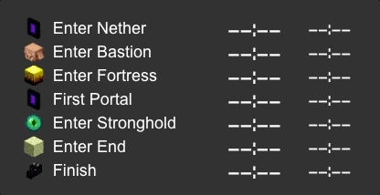
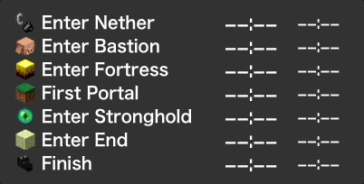
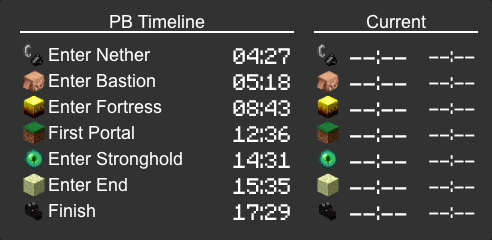
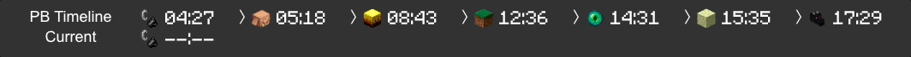

# MCSR (Minecraft Speedrunning) Pace Widget

[README in English](README.md)

Minecraft スピードラン（RSG）の配信を強化するペース表示ウィジェットです。
SpeedRunIGT と連携し、各スプリットのタイムと目標タイムとの差分をリアルタイムで表示します。
自己ベスト・目標ペースなど自由に基準タイムを設定でき、
OBS のブラウザソースとしてテーマを切り替えるだけで配信画面にすぐ組み込めます。

## 特徴

- **タイムライン** — 現在のペースと自己ベスト（PB）との差分をテーブル表示
- **ビジュアルタイムライン** — バー形式で進行状況を視覚的に表示
- **セグメント** — 現在の区間を表示。バナー演出や常時表示などCSSで自由にカスタマイズ可能
- CSSのdata属性による柔軟なテーマスタイリング
- SpeedRunIGT と連携したリアルタイム更新
- MCSRリタイム対応（13分以内のランで自動的にポーズ時間を加算）

## 必要条件

- SpeedRunIGT 14.0 以降
  - **SpeedRunIGT オプション > タイマー で「自動保存間隔」を `Ticks` に設定してください** — スプリットをリアルタイムで表示するために必要です

## インストール

[リリースページ](https://github.com/mcrtabot/MCSRPaceWidget/releases)から zip をダウンロードし、解凍します。

### スタンドアロン実行

1. `mcsr-pace-widget.jar` を実行
2. `open MCSR Pace Widget` をクリック（http://127.0.0.1:1161 が開きます）
3. テーマを選択し、ウィジェット URL をコピー
4. OBS のブラウザソースに URL を設定

### Jingle プラグインとして実行

1. ホームディレクトリに `.config/MCSRPaceWidget` ディレクトリを作成し、解凍した `theme` と `setting` をコピー
   - Windows: `C:\Users\<ユーザー名>\.config\MCSRPaceWidget`
2. `mcsr-pace-widget.jar` を Jingle プラグインディレクトリにコピー
   - `C:\Users\<ユーザー名>\.config\Jingle\plugins`
3. Jingle を再起動し、Plugins > MCSR Pace Widget タブを開く
4. `open MCSR Pace Widget` をクリックし、テーマを選択
5. OBS のブラウザソースにウィジェット URL を設定

## 設定

`setting` と `theme` ディレクトリは以下のいずれかに配置します（上が優先）:

1. `~/.config/MCSRPaceWidget/` 内
2. `mcsr-pace-widget.jar` と同じディレクトリ内

### PB タイム設定

PB を設定しなくてもウィジェットは動きます（Visual Timeline は PB が無ければランの長さに合わせて表示します）。
自己ベストとの差分を表示したい場合に、PB タイムを設定します。

- MCSRPaceWidget ウィンドウ（または Jingle タブ）で `Pace Settings...` をクリック
- `12:34`（12分34秒）または `12:34.567`（12分34.567秒）の形式で入力

### 顔を自分のスキンにする

Visual Timeline の顔キャラクターを、自分の Minecraft スキンにできます。
既定で有効です。アカウントはランのデータから自動で判別するため、入力は不要です。
自前の顔画像を持つテーマはそちらが優先されます。どちらを使うかはテーマ側の CSS が
決めるので、自作テーマにも同じルールが適用されます（同梱の `niwatori` テーマがこの形です）。

テーマ側の画像に戻したい場合は URL に `?face=theme`、逆にスキンを強制したい場合は
`?face=skin` を付けてください。別のアカウントを指定したい場合（他人のランを配信する
場合など）は、`setting/player.json` の `id` に Minecraft ID か UUID を設定してください。
スキンを読み込めなかったときは、テーマ側の顔画像が表示されます。

### CSS を書かずにテーマを調整する

[Playground](/playground) でベーステーマを選び、色・フォント・サイズ・各部分の表示を
フォームから調整できます。変更内容を含んだウィジェット URL が生成されるので、それを
OBS に貼るだけです。ファイルを編集する必要はなく、URL をそのまま人に渡せます。

### カスタムテーマ

1. `theme` ディレクトリ内のベーステーマ（例: `default`）をコピーしてリネーム
2. `setting.json` とスタイルシート（`timeline.css` / `indicator.css` / `segment.css`）を編集
3. [Playground](/playground) で様々なデータパターンでプレビュー

スプリットのアイコンは `icon` ディレクトリの共通アイコンセットから読み込みます。
`setting.json` の `"iconSet"`（`default` / `paceman`）で選択するため、
テーマごとに画像を持つ必要はありません。
ウィジェットの URL に `?icons=<セット名>` を付けると、ファイルを編集せずに別のセットを試せます。

Minecraft フォントが同梱されています。テーマ CSS で `font-family: 'Minecraft-Regular'` を指定すると、より Minecraft らしい見た目にできます。

テーマ開発の詳細は [テーマ開発ガイド](resources/THEME_GUIDE.md) を参照してください。

## テーマ一覧

Default / Texture-bar

Standard

Standard-full

Paceman（最新イベントのみ表示）

Paceman-list

Horizontal-timeline

Niwatori

## FAQ

**Q: Enter Bastion や Enter Fortress などのスプリットがすぐに表示されない**

A: SpeedRunIGT オプション > タイマー で「自動保存間隔」が `Ticks` になっているか確認してください。
この設定がされていないと、スプリットデータがリアルタイムで書き出されず、表示が遅延します。

## 開発

開発に参加する場合は [CONTRIBUTING.md](CONTRIBUTING.md) を参照してください。

## 関連プロジェクト

- [MCSRImageBuilder](https://github.com/mcrtabot/MCSRImageBuilder) — ランのタイムライン画像を生成するWebツール
